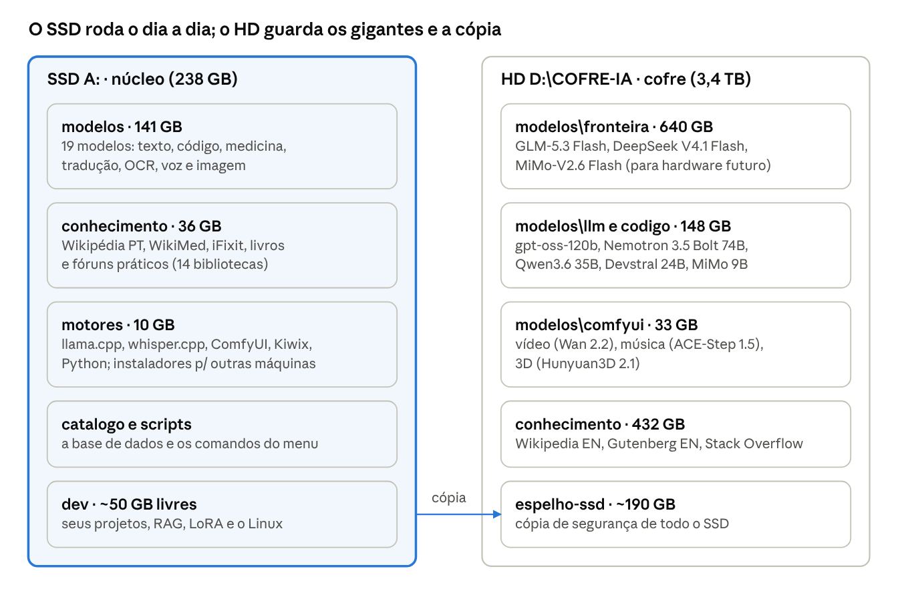

# Guia do SSD de IAs Locais

Cópia offline, atualizada em 27/10/2026. A versão viva (atualizada) está em https://claude.ai/artifact/XuMQNn1aZENjqeAZKDqruw

## Visão geral

O SSD **A:** (ADATA LEGEND 710, NVMe, 256 GB, rótulo PRIVADO) é uma biblioteca offline de IAs: modelos abertos baixados, os programas que os rodam, um catálogo do que existe e os seus próprios projetos. Tudo roda a partir dele, sem internet e sem depender de nenhuma empresa.

O projeto tem cinco partes:

- **Modelos**: 31 modelos abertos, do assistente geral aos especialistas em código, medicina, tradução, documentos, voz, imagem, vídeo, música e 3D, mais os gigantes de fronteira para hardware futuro.
- **Conhecimento**: 17 bibliotecas offline (Wikipédia em português e inglês, enciclopédia médica, manuais de conserto, livros, fóruns práticos), para o modelo responder citando fonte em vez de inventar.
- **Motores**: os programas que rodam tudo (llama.cpp, whisper.cpp, ComfyUI, Kiwix, Python), portáteis, mais instaladores para Linux, Mac, Raspberry Pi e Android.
- **Catálogo**: uma base de dados (`catalogo\modelos.json`) com cada item, tamanho, licença, hash e versão, e scripts que checam novidades toda semana.
- **Desenvolvimento próprio**: seus códigos, datasets, busca nos seus documentos (RAG) e treino de modelos (LoRA).

Como 256 GB não comportam um cofre completo, ele tem duas camadas: o SSD A: é o **núcleo** (o que você usa no dia a dia, rápido) e o HD **D:** guarda o **cofre profundo** em `D:\COFRE-IA` (gigantes, bibliotecas enormes e uma cópia do SSD). Juntos somam cerca de 1,6 TB.

## Estado da arte (outubro de 2026)

Os modelos abertos mais fortes hoje têm de 321 bilhões a 2,8 trilhões de parâmetros e não cabem neste PC. O que roda bem aqui são modelos de 9 a 80 bilhões, principalmente os do tipo **MoE** (mistura de especialistas), que usam só 3 a 4 bilhões de parâmetros por palavra gerada e por isso ficam rápidos mesmo sem caber inteiros na placa de vídeo.

### Fronteira: os melhores abertos do mundo

| Modelo | Empresa | Parâmetros | Licença | Índice Artificial Analysis | No seu cofre |
| --- | --- | --- | --- | --- | --- |
| MiMo-V2.6-Pro | Xiaomi | 1,02 tri | MIT | 46,3 | versão Flash (311 bi) |
| DeepSeek V4.1 Flash | DeepSeek | 763 bi | MIT | 45,1 | sim, em Q2 (313 GB) |
| GLM-5.3 | Z.ai | 753 bi | própria | 44,8 | versão Flash |
| Kimi K3 | Moonshot AI | 2,78 tri | própria | 43,6 | não, só observado |
| GLM-5.3 Flash | Z.ai | 321 bi | MIT | 41,8 | sim, em Q4 (170 GB) |

Índice de 19/10/2026; as diferenças entre os cinco primeiros não são estatisticamente firmes.

### O acervo, por área

| Área | Modelo | Para quê | Onde | GB | Licença |
| --- | --- | --- | --- | --- | --- |
| Geral | Gemma 4 26B-A4B | assistente rápido, entende imagens | SSD | 16,9 | Apache 2.0 |
| Geral | Gemma 4 12B QAT | o mais rápido, cabe inteiro na placa | SSD | 6,7 | Apache 2.0 |
| Geral | Qwen3.8 27B | melhor qualidade densa, lento aqui | SSD | 17,2 | Apache 2.0 |
| Geral | Qwen3.6 35B-A3B | alternativa MoE rápida | cofre | 21,7 | Apache 2.0 |
| Geral | Nemotron 3.5 Bolt 74B-A9B | o maior que roda com folga aqui (5 a 7 tokens/s) | cofre | 48,4 | NVIDIA Open |
| Raciocínio | gpt-oss-20b | raciocínio e ferramentas, o mais veloz | SSD | 11,3 | Apache 2.0 |
| Raciocínio | gpt-oss-120b | roda no limite: ocupa toda a RAM, ~3 tokens/s | cofre | 59,0 | Apache 2.0 |
| Raciocínio | MiMo-V2.6 Distill 9B | raciocínio leve | cofre | 5,4 | MIT |
| Código | Qwen3-Coder-Next | agente de programação (80 bi, 3 bi ativos) | SSD | 35,8 | Apache 2.0 |
| Código | Devstral Small 2 | segundo agente de código | cofre | 13,5 | Apache 2.0 |
| Medicina | MedGemma 27B | sintomas, remédios, primeiros socorros | SSD | 15,7 | HAI-DEF (Google) |
| Tradução | TranslateGemma 12B | 55 idiomas, inclusive texto em fotos | SSD | 7,4 | Gemma |
| Documentos | GLM-OCR | ler fotos e PDFs escaneados, tabelas | SSD | 1,3 | MIT |
| Leves | Gemma 4 E4B QAT | notebook sem placa de vídeo | SSD | 5,7 | Apache 2.0 |
| Leves | Qwen3.5 2B | celular e Raspberry Pi | SSD | 1,9 | Apache 2.0 |
| Leves | LFM2.5 1.2B | rápido em CPU antiga | SSD | 0,7 | LFM 1.0 |
| Leves | Qwen3.5 0.8B | o menor que ainda é útil | SSD | 0,5 | Apache 2.0 |
| Busca | Qwen3-Embedding 0.6B | vetores para buscar nos documentos | SSD | 0,6 | Apache 2.0 |
| Busca | Qwen3-Reranker 0.6B | ordena resultados por relevância | SSD | 0,6 | Apache 2.0 |
| Busca | EmbeddingGemma 2 | vetores leves e multilíngues | SSD | 0,3 | Apache 2.0 |
| Voz | Whisper large-v3-turbo | voz para texto, 99 idiomas | SSD | 0,8 | MIT |
| Voz | Piper pt-BR (faber e cadu) | texto para voz só com CPU (`falar.ps1`) | SSD | 0,1 | dados CC0, motor GPL |
| Voz | Kokoro 82M | vozes mais naturais; precisa do espeak-ng instalado | SSD | 0,3 | Apache 2.0 |
| Imagem | Z-Image-Turbo | gerar imagens a partir de texto | SSD | 17,0 | Apache 2.0 |
| Vídeo | Wan 2.2 TI2V 5B | vídeos curtos em 720p | cofre | 16,9 | Apache 2.0 |
| Vídeo | Wan Animate 2 14B | anima a pessoa de uma foto com os movimentos de um vídeo | cofre | 23,9 | Apache 2.0 |
| Música | ACE-Step 1.5 Turbo | músicas com letra e voz | cofre | 9,3 | Apache 2.0 |
| 3D | Hunyuan3D 2.1 | objeto 3D a partir de uma foto | cofre | 6,9 | Tencent Community |
| Fronteira | GLM-5.3 Flash | top 6 mundial, para hardware futuro | cofre | 169,5 | MIT |
| Fronteira | DeepSeek V4.1 Flash | 2º entre os abertos, em Q2 | cofre | 312,7 | MIT |
| Fronteira | MiMo-V2.6 Flash | versão Flash do líder do ranking | cofre | 157,3 | MIT |

São 141 GB no SSD e 821 GB no cofre. Os três gigantes de fronteira não rodam bem neste PC (precisam de 200 a 400 GB de memória), mas ficam guardados para um computador melhor no futuro. Ficam só em observação: Kimi K3 (2,8 trilhões, licença própria), FLUX 3 klein (exige login no Hugging Face) e Qwen-Image 2.1 (só uso não comercial).

## Seu hardware e o sistema

O PC roda bem modelos de até cerca de 45 GB: a placa de vídeo segura 12 GB e o resto fica nos 64 GB de RAM. O Nemotron 74B (48 GB) ainda funciona bem; o gpt-oss-120b (59 GB) funciona, mas ocupa toda a RAM: feche os outros programas antes de usá-lo.

| Peça | O que você tem | O que isso permite |
| --- | --- | --- |
| Placa de vídeo | NVIDIA RTX 4070, 12 GB | modelos de até ~10 GB rodam inteiros na GPU, os mais rápidos |
| Memória RAM | 64 GB DDR5-5600 | modelos MoE grandes, como o Qwen3-Coder-Next (36 GB) |
| Processador | AMD Ryzen 9 7900X, 12 núcleos | processa a parte do modelo que fica na RAM |
| SSD A: | ADATA LEGEND 710, NVMe, 256 GB | 238 GB úteis; carrega um modelo de 17 GB em segundos |

**Quantização** é a compressão dos pesos. O formato GGUF em Q4 guarda cerca de 4,5 bits por peso: o arquivo fica com uns 0,6 GB por bilhão de parâmetros, com perda de qualidade pequena.

Velocidade medida neste PC em 25/10/2026, com o llama.cpp b11889 (10 tokens por segundo já é leitura confortável):

| Modelo | Tokens por segundo | Por quê |
| --- | --- | --- |
| gpt-oss-20b | 77 | MoE pequeno, quase todo na placa |
| Gemma 4 12B QAT | 56 | cabe inteiro na placa |
| Gemma 4 26B-A4B | 54 (45 sem MTP) | MoE, parte na RAM; cabeça MTP ligada |
| Qwen3-Coder-Next | 29 | MoE de 80 bi, 36 GB na RAM |
| Qwen3.8 27B | 7,9 (4,5 sem MTP) | denso, 40% na RAM; a cabeça MTP prevê vários tokens de uma vez |
| MedGemma 27B | 4,5 | denso: use para perguntas importantes |
| Nemotron 3.5 Bolt 74B (do HD, 27/10) | 5 a 7 | MoE de 48 GB; carrega em ~5 min e deixa ~9 GB de RAM livres |
| gpt-oss-120b (do HD, 27/10) | ~3 (1 na primeira resposta) | 59 GB; carrega em ~4 min e sobra menos de 1 GB de RAM |

A cabeça MTP (arquivo `mtp-*.gguf` na pasta do modelo) deixa o Qwen3.8 27B 76% mais rápido e o Gemma 4 26B 21%; os servidores a usam sozinhos.

O monitor ligado na RTX 4070 gasta 1,7 GB de VRAM só com a tela. Ligando o monitor na saída de vídeo da placa-mãe, a GPU fica livre para a IA.

**Windows ou Linux?** Continue no Windows, com o SSD em NTFS, e adicione Linux pelo WSL2 quando precisar (disco virtual em `A:\linux`). Não instale Linux direto neste SSD: formatar em ext4 deixaria os modelos invisíveis para o Windows.

## Estrutura do cofre

Modelos no HD carregam mais devagar (~150 MB/s contra ~3 GB/s do SSD), mas funcionam do mesmo jeito. Para trazer um modelo do cofre para o SSD, mude o campo `local` dele no catálogo e rode `mover-modelo.ps1`.

## Como usar

Tudo começa com dois cliques em **`A:\IA.cmd`**, que abre o menu. Nada foi instalado no Windows: os programas rodam de dentro do SSD.

Mais fácil ainda: dois cliques em **`A:\Painel.cmd`** abrem a **Central do Cofre** no navegador (http://127.0.0.1:8070). Ela mostra o que está ligado, liga cada serviço com um clique, mostra o consumo da placa de vídeo, a RAM livre e os modelos na memória (com botão para descarregar), busca na biblioteca e fecha tudo no fim. A Central só atende este PC e recusa pedidos vindos de outros sites.

| Opção do menu | O que faz | Onde abre |
| --- | --- | --- |
| 1. Chat com todos os modelos | um servidor só com todos os modelos; escolha o modelo no topo do chat (na primeira vez, cole a chave de acesso) | http://127.0.0.1:8080 |
| 2. Biblioteca offline | Wikipédia, WikiMed, iFixit e as outras bibliotecas, com busca | http://127.0.0.1:8081 |
| 3. Perguntar com fonte | busca na biblioteca e o modelo responde citando [1], [2] | no terminal |
| 4. Imagem, vídeo, música, 3D | ComfyUI (Workflow > Browse Templates) | http://127.0.0.1:8188 |
| 5. Transcrever áudio | Whisper; gera `.txt` e legenda `.srt` ao lado do arquivo | no terminal |
| 13. Conselho de IAs | várias IAs respondem e um relator decide a resposta final | http://127.0.0.1:8090 |
| 14. Medir energia | consumo do PC e custo em reais | no terminal |
| 15. Fechar tudo | fecha servidor, biblioteca, ComfyUI e conselho; libera a placa de vídeo | no terminal |
| 16. Central do Cofre | vê o que está ligado e liga ou desliga com um clique (o mesmo que `Painel.cmd`) | http://127.0.0.1:8070 |

Testado neste PC de 25 a 29/10/2026:

| Teste | Resultado | Tempo |
| --- | --- | --- |
| Perguntar com fonte ("Como purificar água para beber?") | resposta citando Wikipédia e WikiMed | 95 s |
| Imagem 1024x1024 (Z-Image-Turbo) | foto realista (`primeira-imagem-gerada.png`) | 24 s |
| Vídeo de 2 s em 1280x704 (Wan 2.2 5B) | painel solar ao nascer do sol | 9 min |
| Animação de 81 quadros (Wan Animate 2 + LoRA lightx2v) | a pessoa da foto repete os passos do vídeo guia | 28 min |
| Transcrição (Whisper) | áudio em português transcrito certo | 2 s |
| Voz (Piper) | frase em português; o Whisper entendeu de volta | 3 s |
| OCR (GLM-OCR) | receita lida de uma imagem sem erros | 5 s |
| Música de 30 s com letra em português (ACE-Step 1.5) | MPB com violão; o Whisper transcreveu a letra certa (`musica-cofre.flac`) | não cronometrado |
| Objeto 3D a partir de uma foto (Hunyuan3D 2.1) | caneca em `.glb` de 10,5 MB (`caneca-3d.glb`) | 2 min 19 s |
| Conselho de IAs, pergunta de código | 3 IAs + relator; resposta certa sobre `${pasta}:` no PowerShell | 3 min 17 s |
| Conselho de IAs, pergunta geral (energia solar e bateria para o PC) | sistema híbrido, contas de bateria certas (~95 Ah de lítio em 12 V) | 5 min 47 s |
| Conselho de IAs com o Qwen3.8 de relator | guia de armazenamento de água; o relator descartou uma dose de iodo 1.000 vezes acima da segura | 13 min 53 s |
| gpt-oss-120b, do HD (bateria de 12 V para geladeira) | conta certa (10 h), com fórmulas em LaTeX; sobrou menos de 1 GB de RAM | 8 min, sendo 4 carregando |
| Nemotron 3.5 Bolt 74B, do HD (mesma pergunta) | conta certa (10 h), em texto simples; sobraram 8,6 GB de RAM | 6 min 14 s, quase 5 carregando |
| Modelo parado sai da memória sozinho | depois de 1 min sem uso (teste) a placa liberou o modelo e acordou em 1 s na pergunta seguinte | 1 s para voltar |
| Chave de acesso (29/10) | pedido de um site estranho barrado (401); o chat pediu a chave uma vez e abriu; conselho e "Perguntar" usam a chave sozinhos | na hora |
| Central do Cofre (29/10) | ligou o chat com um clique, mostrou o modelo na memória, descarregou e fechou tudo sem se fechar | ~10 s para o chat ligar |
| Busca na biblioteca por idioma (29/10) | "purificar água" achou Wikipédia e Wikcionário; "water purification", Wikipédia, WikiMed e Stack Exchange | na hora |

Pelo terminal, com o ComfyUI aberto: `gerar.ps1 -Imagem "..."`, `gerar.ps1 -Video "..."` ou `gerar.ps1 -Animar -Foto x.png -Movimento y.mp4` (menu, opção 11). Exemplos em `A:\dev\midia-gerada`.

O servidor também é uma API compatível com a da OpenAI em `http://127.0.0.1:8080/v1`, com `model` igual ao id do catálogo e a chave de acesso no campo "API key". Configuração pronta para o Continue (VS Code) em `A:\dev\configs\continue-config.yaml`.

**Chave de acesso.** Sem ela, qualquer site aberto no navegador poderia mandar o PC rodar modelos escondido: gastaria energia e, com um gigante, poderia travar o PC sem memória. O servidor cria a chave na primeira vez em `A:\catalogo\chave-api.txt` (o arquivo nunca vai para o GitHub), mostra na janela e a copia para a área de transferência. O chat pede uma vez por navegador: cole com Ctrl+V e clique em "Save & Retry". O conselho e o "Perguntar com fonte" usam a chave sozinhos. O painel do conselho (porta 8090) não precisa dela: ele recusa pedidos vindos de outros sites. Para desligar a chave (não recomendado): `iniciar-servidor.ps1 -SemChave`.

Para usar do celular ou de outro PC da rede: `iniciar-servidor.ps1 -Rede` e `iniciar-biblioteca.ps1 -Rede`; no celular, o chat pede a mesma chave. Se este PC quebrar, `A:\motores\llama.cpp-outras-maquinas` tem o llama.cpp para Windows sem GPU, Vulkan, Linux, Raspberry Pi, Mac e Android, mais o código-fonte.

Fora do menu: `powershell -ExecutionPolicy Bypass -File A:\scripts\<script>.ps1`. Ajuda: `Get-Help A:\scripts\baixar-modelo.ps1 -Examples`.

## Conselho de IAs

Várias IAs do acervo respondem à mesma pergunta sem ver umas às outras. Depois, um relator compara as respostas, refaz as contas, descarta os erros e escreve a resposta final, dizendo onde houve consenso e onde houve divergência. Como os modelos vêm de laboratórios diferentes (Google, OpenAI, Alibaba), costumam errar em coisas diferentes, e um corrige o outro. No teste, um membro recomendou uma dose de iodo 1.000 vezes acima da segura; o relator refez a conta e descartou o valor.

Como uma pergunta passa pelo conselho:

1. **Triagem.** O Gemma 4 26B identifica o assunto e chama o especialista: código → Qwen3-Coder-Next, saúde → MedGemma 27B, tradução → TranslateGemma.
2. **Fontes** (opcional). Trechos da biblioteca offline, como no "Perguntar com fonte", lidos por todos.
3. **Imagem** (opcional). Um modelo que enxerga descreve a foto para os membros que só leem texto.
4. **Rodada 1.** Cada membro responde sozinho.
5. **Rodada 2** (modos debate e profundo). Cada membro lê as outras respostas, aponta erros e revisa a sua.
6. **Relator.** Escreve a resposta final e a seção "Como o conselho decidiu".

A placa de vídeo comporta um modelo grande por vez, então os membros falam em fila; cada troca de modelo leva de 8 a 20 segundos.

| Modo | Quem participa | Tempo |
| --- | --- | --- |
| Rodada única (padrão) | Gemma 4 26B, gpt-oss-20b e Qwen3.8 27B (ou o especialista do assunto); relator Gemma 4 26B | 3 a 6 min (medido: 3 min 17 s numa pergunta de código) |
| Debate | o mesmo, mais a rodada de revisão | cerca do dobro |
| Profundo | debate, mais raciocínio e o Qwen3.8 27B de relator | 15 a 25 min; para decisões importantes |

Como usar:

- **Painel:** menu, opção 13, abre http://127.0.0.1:8090. Escreva a pergunta, escolha o modo e, se quiser, anexe uma foto. Os cartões mostram o que cada IA disse.
- **Terminal:** `conselho.ps1 "pergunta"`, `conselho.ps1 "pergunta" -Debate`, `conselho.ps1 "pergunta" -Profundo` e `conselho.ps1 "o que diz esta placa?" -Imagem C:\foto.jpg`.
- **Outros programas** (Open WebUI, Continue, scripts): API compatível com a da OpenAI em `http://127.0.0.1:8090/v1`, modelos `conselho`, `conselho-debate` e `conselho-profundo`.
- **Atas:** cada deliberação fica em `A:\dev\conselho` (Markdown), com a resposta de cada IA. Essa pasta não vai para o GitHub.
- **Trocar o time:** seção `conselho` de `catalogo\modelos.json` (`membros`, `relator`, `relator_profundo`, `especialistas`). Prefira membros de laboratórios diferentes.

## Custo de energia

Este PC não tem sensor de consumo total. O script `medir-energia.ps1` (menu, opção 14) mede a placa de vídeo pelo sensor da NVIDIA e estima o resto (processador, placa-mãe, memória, discos e perdas da fonte) pela carga do processador; a margem de erro é de uns 20%. Para medir na tomada de verdade, use um medidor de tomada (wattímetro). Cada medição fica anotada em `A:\logs\energia.csv`.

Os valores usam R$ 1,00 por kWh, um número redondo com impostos. Troque pela sua tarifa: total da conta ÷ kWh consumidos. Exemplo: `medir-energia.ps1 -Segundos 60 -Tarifa 0.92`.

**Medido em 26/10/2026:**

| Situação | Potência média do PC | Energia | Custo |
| --- | --- | --- | --- |
| PC ligado sem uso (com o download do cofre rodando) | 114 W | 114 Wh por hora | R$ 0,11 por hora |
| Pergunta no chat (Gemma 4 26B, incluindo carregar o modelo) | 160 W por 33 s | 1,4 Wh | R$ 0,0014 |
| Conselho de IAs, rodada única | 183 W por 3 min 48 s | 11,5 Wh | R$ 0,012 |
| Conselho com o Qwen3.8 27B de relator | 217 W por 13 min 54 s | 50 Wh | R$ 0,05 |

Com os modelos de texto, a placa de vídeo nunca passou de 118 W: o gargalo é a memória, e o processador faz parte do trabalho.

**Estimado** (no ComfyUI e no treino a placa trabalha no limite dela, 200 W; o PC inteiro fica perto de 330 a 350 W, cerca de 5,5 Wh por minuto):

| Tarefa | Energia | Custo |
| --- | --- | --- |
| Imagem (Z-Image, 24 s) | ~2,5 Wh | R$ 0,003 |
| Objeto 3D (Hunyuan3D, 2 min 19 s) | ~13 Wh | R$ 0,013 |
| Vídeo de 2 s (Wan 2.2, 9 min) | ~50 Wh | R$ 0,05 |
| Animação de 81 quadros (Wan Animate 2, 28 min) | ~155 Wh | R$ 0,16 |

**Manutenção do cofre:**

| Tarefa | Energia | Custo |
| --- | --- | --- |
| Verificação semanal de novidades (23 s) | 0,7 Wh | menos de R$ 0,01 por mês |
| Sincronização das atualizações (~150 GB por mês, ~2 h) | ~0,25 kWh | ~R$ 0,25 por mês |
| Conferência completa do SHA256 (a cada 3 meses, ~1,5 h lendo o HD) | ~0,19 kWh | ~R$ 0,06 por mês |
| Montagem inicial do cofre (~1,5 TB, ~20 h baixando) | ~2,3 kWh | ~R$ 2,30, uma vez |

**Aprimoramento** (treinar e avaliar os seus modelos):

| Tarefa | Energia | Custo |
| --- | --- | --- |
| Treinar uma LoRA de texto (modelo de 4 a 8 bi, 1 a 3 h, ~350 W) | 0,35 a 1,05 kWh | R$ 0,35 a 1,05 |
| Treinar uma LoRA de imagem (1 a 2 h) | 0,35 a 0,7 kWh | R$ 0,35 a 0,70 |
| Gerar 1.000 exemplos de treino com um modelo só (Gemma 4 26B) | ~1,4 kWh | ~R$ 1,40 |
| Gerar 1.000 exemplos revisados pelo conselho | ~11,5 kWh | ~R$ 11,50 |
| Avaliar um modelo novo com 200 perguntas | ~0,3 kWh | ~R$ 0,30 |

**Por mês**, somando o PC ligado, o uso e a manutenção:

| Perfil | Como usa | Energia | Custo |
| --- | --- | --- | --- |
| Leve | 1 h por dia: 20 perguntas, 2 conselhos e 5 imagens | ~4,4 kWh | ~R$ 4,40 |
| Intenso | 6 h por dia: 100 perguntas, 10 conselhos, 20 imagens e 1 vídeo; 1 LoRA por semana | ~27 kWh | ~R$ 27 |
| Servidor sempre ligado | 24 h por dia, com o uso intenso | ~89 kWh | ~R$ 89 |

As IAs em si custam centavos: uma resposta do conselho sai por cerca de R$ 0,01. De 75% a 90% da conta é o PC ligado esperando. Para comparar, um chuveiro elétrico de 5.500 W usado 10 minutos por dia gasta uns 27 kWh por mês, o mesmo que o perfil intenso.

Para gastar menos:

1. **Suspenda o PC quando não estiver usando.** Deixá-lo ligado 24 h custa uns R$ 82 por mês só esperando. No Windows: Configurações → Sistema → Energia → Suspender após 30 min. Os scripts de download já impedem a suspensão enquanto baixam.
2. **Limite a placa de vídeo a 160 W** para vídeo e treino: menos 15% a 20% de energia, alguns por cento mais lento; os modelos de texto não mudam, pois nunca passam de 118 W. No Prompt de Comando como administrador: `nvidia-smi -pl 160` (volta a 200 W ao reiniciar).
3. **Deixe o HD D: dormir** quando parado: Opções de energia → Disco rígido → Desligar após 20 min (economiza uns 5 W).
4. **Use o chat para perguntas do dia a dia** e o conselho quando quiser uma segunda opinião. O modo profundo gasta umas 4 vezes mais que a rodada única.
5. **Se tiver tarifa branca**, rode a sincronização fora do horário de ponta. A verificação semanal (segunda, 10h) já está fora da ponta.
6. **Feche tudo ao terminar**: opção 15 do menu (`parar-tudo.ps1`). Mesmo sem isso, o servidor de modelos tira da memória o modelo parado há 15 minutos e o recarrega na próxima pergunta (`iniciar-servidor.ps1 -DormirMinutos 30` muda o tempo; `0` desliga). A opção 6 (status) mostra o que do cofre ainda está aberto.

## Catálogo e atualização constante

Toda segunda às 10h o Windows **verifica** novidades sozinho; a opção **8 do menu** (`sincronizar-cofre.ps1`) **baixa** o que mudou.

| Arquivo | O que guarda | Quem escreve |
| --- | --- | --- |
| `catalogo\modelos.json` | cada modelo, biblioteca e motor | você |
| `catalogo\estado.json` | o que foi baixado, com SHA256, data e versão | os scripts |
| `catalogo\relatorios\AAAA-MM-DD.md` | relatório de cada verificação | `verificar-atualizacoes.ps1` |
| `SHA256SUMS.txt` (raiz de cada disco) | hashes de tudo, formato padrão | `verificar-integridade.ps1` |

A sincronização pode ser interrompida e rodada de novo: continua de onde parou. Para adicionar um modelo, copie um bloco em `modelos.json`, ajuste e rode `baixar-modelo.ps1 -Id <id>`.

### GitHub

O cérebro do cofre (scripts, catálogo, guia e ferramentas, cerca de 3 MB) é um repositório git na raiz do SSD, publicado em github.com/jvlcg/PRIVADO (repositório público). Modelos e bibliotecas ficam de fora. Cada sincronização registra as mudanças e envia ao GitHub sozinha.

- Parar de enviar: em `catalogo\modelos.json`, mude `"enviar_automatico"` para `false`.
- Tornar privado depois: PRIVADO → Settings → Danger Zone → Change repository visibility → Make private.
- Ver e enviar à mão: GitHub Desktop → File → Add local repository → `A:\`.
- Plugin do GitHub no Claude: crie um token (github.com/settings/personal-access-tokens) só para o PRIVADO, salve na variável `GITHUB_PERSONAL_ACCESS_TOKEN` do Windows e reinicie o app.

## Desenvolvimento próprio

- `dev\projetos`: seus repositórios. `dev\datasets`: dados e o banco de busca (`sabio.sqlite`).
- RAG nos seus documentos: `perguntar.ps1 -Indexar <pasta>` e depois `perguntar.ps1 -Buscar "pergunta"`.
- LoRA: instale o WSL2 (`instalar-wsl.ps1` como administrador), rode `bash /mnt/a/linux/configurar-ubuntu.sh` e use `dev\lora\treinar-lora.py` (modelo inicial, ainda não testado; baixa ~6 GB na primeira vez).

## Boas práticas de backup

- Cada arquivo foi conferido pelo SHA256 da fonte. A cada três meses: `verificar-integridade.ps1` (sem `-Rapido`). Em Linux: `sha256sum -c SHA256SUMS.txt`.
- Regra 3-2-1: SSD (1), espelho no HD D: (2), e falta um HD externo desligado e guardado em outro lugar (3): `copiar-backup.ps1 -Destino E:\COFRE-IA -Tudo`.
- O HD D: (Seagate ST4000DM004) é SMR: trava com duas gravações grandes ao mesmo tempo, por isso o cofre baixa uma coisa de cada vez. Para a terceira cópia, prefira um HD CMR (linhas NAS, como WD Red Plus ou Seagate IronWolf) ou um SSD.
- Não suspenda o PC durante a sincronização: em 26/10 ele ficou 12 horas suspenso e os downloads pararam.
- Licenças com termos próprios (uso pessoal permitido): MedGemma, TranslateGemma, Nemotron, Hunyuan3D (não vale na UE, Reino Unido e Coreia do Sul), LFM2.5.
- MedGemma erra: use junto com a WikiMed e procure um profissional sempre que puder.

## Fontes

- Ranking: auditoria de 19/10/2026 da Artificial Analysis e do BenchLM (dev.to)
- Modelos: API do Hugging Face, consultada em 25/10/2026
- Bibliotecas: download.kiwix.org
- Motores: GitHub de ggml-org/llama.cpp, ggml-org/whisper.cpp, comfyanonymous/ComfyUI, ollama/ollama, astral-sh/uv; download.kiwix.org/release
- Energia: consumo medido neste PC em 26/10/2026 com `medir-energia.ps1`; tarifa: projeção da Aneel de alta média de 8,6% em 2026 (Poder360) e bandeira de outubro de 2026 (Jornal do Brasil). Confira a sua na conta de luz.
