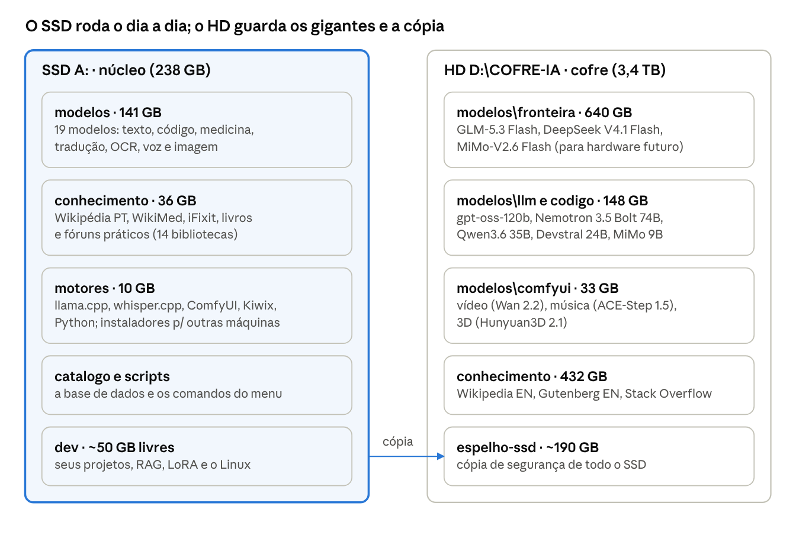

# Guia do SSD de IAs Locais

Cópia offline, atualizada em 27/10/2026. A versão viva (atualizada) está em https://claude.ai/artifact/XuMQNn1aZENjqeAZKDqruw

## Visão geral

O SSD **A:** (ADATA LEGEND 710, NVMe, 256 GB, rótulo PRIVADO) é uma biblioteca offline de IAs: modelos abertos baixados, os programas que os rodam, um catálogo do que existe e os seus próprios projetos. Tudo roda a partir dele, sem internet e sem depender de nenhuma empresa.

O projeto tem cinco partes:

- **Modelos**: 31 modelos abertos, do assistente geral aos especialistas em código, medicina, tradução, documentos, voz, imagem, vídeo, música e 3D, mais os gigantes de fronteira para hardware futuro.
- **Conhecimento**: 68 bibliotecas offline, só em português e inglês (Wikipédia em português e inglês, enciclopédia médica, manuais de conserto, sobrevivência, livros universitários e fóruns práticos), para o modelo responder citando fonte em vez de inventar.
- **Motores**: os programas que rodam tudo (llama.cpp, whisper.cpp, ComfyUI, Kiwix, Python), portáteis, mais instaladores para Linux, Mac, Raspberry Pi e Android.
- **Catálogo**: uma base de dados (`catalogo\modelos.json`) com cada item, tamanho, licença, hash e versão, e scripts que checam novidades toda semana.
- **Desenvolvimento próprio**: seus códigos, datasets, busca nos seus documentos (RAG) e treino de modelos (LoRA).

Como 256 GB não comportam um cofre completo, ele tem duas camadas: o SSD A: é o **núcleo** (o que você usa no dia a dia, rápido) e o HD **D:** guarda o **cofre profundo** em `D:\COFRE-IA` (gigantes, bibliotecas enormes e uma cópia do SSD). Juntos somam cerca de 1,6 TB.

## Estado da arte (outubro de 2026)

Os modelos abertos mais fortes hoje têm de 321 bilhões a 2,8 trilhões de parâmetros e não cabem neste PC. O que roda bem aqui são modelos de 9 a 80 bilhões, principalmente os do tipo **MoE** (mistura de especialistas), que usam só 3 a 4 bilhões de parâmetros por palavra gerada e por isso ficam rápidos mesmo sem caber inteiros na placa de vídeo.

### Fronteira: os melhores abertos do mundo

| Modelo | Empresa | Parâmetros | Licença | Índice Artificial Analysis | No seu cofre |
| --- | --- | --- | --- | --- | --- |
| MiMo-V2.6-Pro | Xiaomi | 1,02 tri | MIT | 46,3 | versão Flash (311 bi) |
| DeepSeek V4.1 Flash | DeepSeek | 763 bi | MIT | 45,1 | sim, em Q2 (313 GB) |
| GLM-5.3 | Z.ai | 753 bi | própria | 44,8 | versão Flash |
| Kimi K3 | Moonshot AI | 2,78 tri | própria | 43,6 | não, só observado |
| GLM-5.3 Flash | Z.ai | 321 bi | MIT | 41,8 | sim, em Q4 (170 GB) |

Índice de 19/10/2026; as diferenças entre os cinco primeiros não são estatisticamente firmes.

### O acervo, por área

| Área | Modelo | Para quê | Onde | GB | Licença |
| --- | --- | --- | --- | --- | --- |
| Geral | Gemma 4 12B QAT | o mais rápido (109 palavras/s), inteiro na placa; também imagem e áudio | SSD | 6,9 | Apache 2.0 |
| Geral | Gemma 4 26B-A4B QAT | o do dia a dia (75 palavras/s), entende imagens | SSD | 14,8 | Apache 2.0 |
| Geral | Qwen3.8 27B (~3 bits) | a melhor resposta do cofre (10 palavras/s; inteiro na placa com o monitor na placa-mãe) | SSD | 10,6 | Apache 2.0 |
| Geral | Nemotron 3.5 Bolt 74B-A9B | o maior que roda com folga aqui (5 a 7 tokens/s) | cofre | 48,4 | NVIDIA Open |
| Raciocínio | gpt-oss-20b | raciocínio e ferramentas, o mais veloz | SSD | 11,3 | Apache 2.0 |
| Raciocínio | gpt-oss-120b | roda no limite: ocupa toda a RAM, ~3 tokens/s | cofre | 59,0 | Apache 2.0 |
| Código | Ornith 1.5 35B-A3B | agente de programação: acertou 100% das chamadas de ferramenta (58 palavras/s) | SSD | 21,1 | MIT |
| Medicina | MedGemma 27B | sintomas, remédios, primeiros socorros | SSD | 15,7 | HAI-DEF (Google) |
| Tradução | TranslateGemma 12B | 55 idiomas, inclusive texto em fotos | SSD | 7,4 | Gemma |
| Documentos | GLM-OCR | ler fotos e PDFs escaneados, tabelas | SSD | 1,3 | MIT |
| Leves | Gemma 4 E4B QAT | notebook sem placa de vídeo | SSD | 5,7 | Apache 2.0 |
| Leves | Qwen3.5 0.8B | celular, Raspberry Pi, o menor que ainda é útil | SSD | 0,5 | Apache 2.0 |
| Busca | Qwen3-Embedding 0.6B | vetores para buscar nos documentos | SSD | 0,6 | Apache 2.0 |
| Busca | Qwen3-Reranker 0.6B | ordena os trechos por relevância | SSD | 0,6 | Apache 2.0 |
| Voz | Whisper large-v3-turbo | voz para texto, 99 idiomas | SSD | 0,8 | MIT |
| Voz | Piper pt-BR (faber e cadu) | texto para voz só com CPU (`falar.ps1`) | SSD | 0,1 | dados CC0, motor GPL |
| Imagem | Z-Image-Turbo | gerar imagens a partir de texto (12 s por imagem) | SSD | 17,0 | Apache 2.0 |
| Vídeo | Wan 2.2 TI2V 5B | vídeos curtos em 720p | cofre | 16,9 | Apache 2.0 |
| Vídeo | Wan Animate 2 14B | anima a pessoa de uma foto com os movimentos de um vídeo | cofre | 23,9 | Apache 2.0 |
| Música | ACE-Step 1.5 Turbo | músicas com letra e voz | cofre | 9,3 | Apache 2.0 |
| 3D | Hunyuan3D 2.1 | objeto 3D a partir de uma foto | cofre | 6,9 | Tencent Community |
| Fronteira | GLM-5.3 Flash | top 6 mundial, para hardware futuro | cofre | 169,5 | MIT |
| Fronteira | DeepSeek V4.1 Flash | 2º entre os abertos, em Q2 | cofre | 312,7 | MIT |
| Fronteira | MiMo-V2.6 Flash | versão Flash do líder do ranking | cofre | 157,3 | MIT |

**Só a nata (06/11/2026):** um modelo, o melhor, para cada tarefa. Saíram as versões antigas que estavam de reserva (Gemma 4 sem QAT, Qwen3.8 em 4 bits) e o que ficou repetido: Qwen3-Coder-Next e Devstral (o Ornith faz o mesmo e acerta mais), Qwen3.6 35B e MiMo 9B (os Gemma QAT e o Qwen3.8 cobrem), Qwen3.5 2B e LFM2.5 (ficaram o Gemma E4B e o Qwen3.5 0.8B), EmbeddingGemma e Kokoro (não eram usados). Os bons continuam no catálogo como "observar", com o motivo, e podem ser baixados de novo a qualquer hora. Os três gigantes de fronteira não rodam bem neste PC (precisam de 200 a 400 GB de memória), mas ficam guardados para um computador melhor no futuro. Também só em observação: Kimi K3 (2,8 trilhões, licença própria), FLUX 3 klein (exige login no Hugging Face) e Qwen-Image 2.1 (só uso não comercial).

### Bibliotecas offline

São 68 no cofre, só em português e inglês, todas conferidas pelo SHA256: as 17 do começo, as de 29/10/2026 (marcadas com *) e as de 05/11/2026 (marcadas com †). Em 06/11/2026 saíram os mapas, a Low-tech Magazine (11 idiomas) e o Projeto Gutenberg em inglês (206 GB de literatura sem busca por texto; segue em observação). Tudo abre na biblioteca (menu, opção 3), e a busca da Central procura em todas de uma vez. Os fóruns de computação (Stack Overflow em inglês e em português, Ask Ubuntu, Unix, Super User e Segurança) ficam fora da busca padrão, para não misturar programação nas perguntas práticas; eles entram quando o conselho trata de código.

| Área | O que tem | GB |
| --- | --- | --- |
| Enciclopédias | Wikipédia em português e em inglês, Wikcionário, Wikivoyage | 138 |
| Saúde | WikiMed, fórum de Ciências Médicas, medicina de campo*, medicina militar*, guias de medicina em vídeo*, LibreTexts Medicina*, WikiVet* (animais), medicamentos do NHS† (para que serve cada remédio, dose e efeitos), saúde do viajante do CDC†, LibrePathology† | 4,3 |
| Sobrevivência | pós-desastre*, tratamento de água*, preparo de alimentos*, nós*, True Prepper*, Ready.gov† (guia oficial dos EUA para emergências e desastres); Survivor Library* (em observação) | 4,8 + 220 |
| Técnica e reconstrução | iFixit, fóruns Faça Você Mesmo e Eletrônica, Restarters*, WikiCiv*, Appropedia*, Energypedia*, CD3WD*, LibreTexts Engenharia e Ofícios*, fóruns de Mecânica de veículos†, Bicicletas†, Marcenaria†, Rádio amador† (comunicação sem celular), Engenharia†, Raspberry Pi†, Arduino†, Artesanato† e Truques do dia a dia† | 14 |
| Agricultura e cozinha | fóruns de Jardinagem e Culinária, Gardenology*, fóruns de Fermentação caseira†, Sustentabilidade† e Animais de estimação† | 1,4 |
| Ensino | Wikilivros, Wikiversidade*, simulações PhET em português*, LibreTexts Física, Matemática, Química, Biologia e Escola*, fóruns de Química†, Biologia†, Física†, Ciências da Terra† e Criação de filhos† | 15 |
| Livros e computação | Projeto Gutenberg em português, Stack Overflow, Stack Overflow em português†, Ask Ubuntu† (Linux para iniciantes), Unix e Linux†, Super User† (Windows e PC) e Segurança† | 117 |

A Survivor Library (220 GB, livros antigos de ofícios) fica em observação: não baixa sozinha (`baixar-conhecimento.ps1 -Id survivor-library`).

### Novidades de novembro de 2026 e o plano para este PC

Pesquisa feita na internet em 05/11/2026, com fontes primárias sempre que possível (cartão do modelo, release no GitHub). Neste PC quase toda IA de texto esbarra na **velocidade da memória**, não na força de cálculo: 504 GB/s na placa de vídeo contra uns 96 GB/s na DDR5. Por isso os maiores ganhos vêm de caber mais coisa na placa e de usar modelos MoE, que só leem uma parte dos pesos a cada palavra.

O que mudou de mais importante:

- **O llama.cpp ganhou versões numeradas e virou "host de agente".** A v0.9.0 é de 04/11/2026, e o cofre está na b9990, de julho. Ela traz MoE fundido no CUDA, um cache de especialistas MoE na placa (`--moe-cache-mib`, +15% a +50% estimados nos MoE grandes), especulação sem modelo extra (`ngram-mod`) e servidores MCP com ferramentas (`--mcp-servers-config`). Tem três quebras: `--mmap` e `--mlock` viraram `--load-mode`, a porta padrão mudou de 8080 para 9931 e o formato de sessão mudou. Fontes: [v0.9.0](https://github.com/ggml-org/llama.cpp/releases/tag/v0.9.0), [MCP no servidor](https://github.com/ggml-org/llama.cpp/pull/26062), [cache de especialistas](https://github.com/ggml-org/llama.cpp/pull/29887).
- **As bibliotecas viram ferramenta de agente.** O [openzim-mcp 3.4.0](https://pypi.org/project/openzim-mcp/) (25/10/2026, MIT) lê os ZIMs direto e entrega busca e leitura para qualquer agente. Um teste de outubro mostrou o erro mais comum dos agentes locais: eles buscam, recebem só o título e desistem sem ler a página ([teste](https://larsensoren.com/writing/local-agent-bench/)). O "perguntar com fonte", que já devolve trechos lidos e reordenados, resolve exatamente isso.
- **Agentes de código locais:** [opencode 2.2.5](https://github.com/anomalyco/opencode/releases) e Qwen Code 0.26.8 estão ativos, e o Aider parou em 2025. Para eles, o [Ornith 1.5 35B-A3B](https://huggingface.co/ornith-ai/Ornith-1.5-35B-A3B) (MIT) acertou 100% das chamadas de ferramenta no ggufbench, no mesmo formato do qwen3.6-35b-a3b que já roda aqui.
- **O Qwen3.8 27B pode caber inteiro na placa.** Hoje ele é o gargalo do conselho (~7 tok/s, metade na RAM). Uma versão em ~3 bits tem 9,4 GiB e cabe nos ~10 GB livres. Os números de velocidade são de blogs e precisam ser medidos aqui ([guia](https://openclawdc.com/blog/best-local-llm-12gb-vram/)).
- **Gemma 4 QAT:** versões treinadas para 4 bits, com MTP, dos mesmos modelos do catálogo (26B-A4B e 12B): mais qualidade no mesmo tamanho ([unsloth](https://huggingface.co/unsloth/gemma-4-26B-A4B-it-qat-GGUF)).
- **Imagem, vídeo e voz:**
  - o FLUX 3 klein saiu (15/10) com arquivos int8 que rodam na 4070;
  - o ComfyUI v0.44 traz atenção rápida embutida (~37% menos tempo por imagem) e modo `--offline`;
  - o LTX-2.5 faz vídeo com áudio, viável com offload na RAM;
  - em voz, o VoxCPM2 clona voz em português e o Granite Speech 5.0 2B transcreve português pelo próprio llama.cpp.
- **Busca com fonte:** o embedding Harrier OSS v1 marca 69,0 contra ~64,3 do atual no MTEB multilíngue. O ganho mais barato, porém, é pôr o título do artigo em cada trecho antes do reordenador, o que agora o cofre já faz, e medir com um conjunto-ouro de perguntas antes de reindexar.

O plano, do que rende mais para o que custa menos:

| # | Ação | Ganho | Custo | Precisa de você |
| --- | --- | --- | --- | --- |
| 1 | Ligar o monitor na saída de vídeo da placa-mãe (iGPU do 7900X) | +1,7 GB na placa para as IAs (14% a mais) | nada | sim: cabo e BIOS |
| 2 | Limitar a placa a 150 W para texto (`nvidia-smi -pl 150`, como administrador; 200 W para jogo e vídeo) | ~16% menos energia por palavra, ~1% mais lento | nada | sim: administrador |
| 3 | **Feito em 05/11:** llama.cpp b12138 (sem versão de reserva desde 06/11), com atenção rápida, memória da conversa em 8 bits, cache de prompt de 16 GB na RAM e folga de memória no roteador | MoE mais rápido, agentes, cache de especialistas | 0,5 GB | |
| 4 | **Feito em 05/11, de outro jeito:** no conselho entrou o qwen3.8-27b-iq3 (e os Gemma QAT), mais rápidos sem perder o modelo mais forte; o qwen3.6-35b-a3b saiu na limpeza de 06/11 | mais rápido por resposta | nada | |
| 5 | **Feito em 05/11:** Agente do Cofre, com 5 ferramentas MCP no próprio servidor (veja "Agente do Cofre" em Como usar) | IA que pesquisa sozinha no acervo offline, citando | 0 GB | |
| 6 | **Feito em 05/11:** Qwen3.8 27B em ~3 bits (`qwen3.8-27b-iq3`), agora no conselho | medido 10 contra 6,5 palavras/s; inteiro na placa só com o monitor na placa-mãe (item 1) | 9,7 GB | |
| 7 | **Feito em 05/11:** Gemma 4 QAT 26B-A4B e 12B como padrão; os antigos foram para o HD | medido: 12B de 54 para 109 palavras/s, 26B de 57 para 75 | 23 GB (substituem 24 GB) | |
| 8 | **Feito em 05/11:** Ornith 1.5 35B-A3B, no SSD desde 06/11 (o opencode ainda falta) | medido 58 palavras/s | 21 GB | instalar o opencode |
| 9 | **ComfyUI feito em 05/11:** v0.44.0, sem internet (`--offline`) e sem os nós pagos; falta o FLUX 3 klein | o FLUX 3 | ~18 GB | login no Hugging Face (FLUX 3) |
| 10 | **Feito em 05/11:** 27 bibliotecas novas (saúde, emergência, conserto, rádio amador, ciência, Linux) e 2 atualizadas | fontes mais novas e mais assuntos | 16 GB | |
| 11 | **Feito em 06/11:** só a nata. Saíram os mapas, as bibliotecas em outros idiomas, as versões de reserva e o espelho do SSD no HD; a Central ganhou o visual no estilo da Apple | ~530 GB livres e um painel mais claro | libera ~48 GB no SSD e ~483 GB no HD | apagar as duas pastas `_para-apagar` |

Ficam em observação no catálogo, sem baixar: Ornith 1.5 9B, Harrier (embeddings), Granite Speech 5.0, VoxCPM2 e LTX-2.5. Não valem para esta placa, porque exigem placas mais novas (Blackwell) ou bem maiores: arquivos NVFP4, Nemotron 3.5 Transcribe, MiniMax H3 e Wan 2.7/3.0.

## Seu hardware e o sistema

O PC roda bem modelos de até cerca de 45 GB: a placa de vídeo segura 12 GB e o resto fica nos 64 GB de RAM. O Nemotron 74B (48 GB) ainda funciona bem; o gpt-oss-120b (59 GB) funciona, mas ocupa toda a RAM: feche os outros programas antes de usá-lo.

| Peça | O que você tem | O que isso permite |
| --- | --- | --- |
| Placa de vídeo | NVIDIA RTX 4070, 12 GB | modelos de até ~10 GB rodam inteiros na GPU, os mais rápidos |
| Memória RAM | 64 GB DDR5-5600 | modelos MoE grandes, como o gpt-oss-120b (59 GB) |
| Processador | AMD Ryzen 9 7900X, 12 núcleos | processa a parte do modelo que fica na RAM |
| SSD A: | ADATA LEGEND 710, NVMe, 256 GB | 238 GB úteis; carrega um modelo de 17 GB em segundos |

**Quantização** é a compressão dos pesos. O formato GGUF em Q4 guarda cerca de 4,5 bits por peso: o arquivo fica com uns 0,6 GB por bilhão de parâmetros, com perda de qualidade pequena.

Velocidade medida neste PC em 25/10/2026, com o llama.cpp b11889 (10 tokens por segundo já é leitura confortável):

| Modelo | Tokens por segundo | Por quê |
| --- | --- | --- |
| gpt-oss-20b | 77 | MoE pequeno, quase todo na placa |
| Gemma 4 12B QAT | 56 | cabe inteiro na placa |
| Gemma 4 26B-A4B | 54 (45 sem MTP) | MoE, parte na RAM; cabeça MTP ligada |
| Qwen3-Coder-Next | 29 | MoE de 80 bi, 36 GB na RAM |
| Qwen3.8 27B | 7,9 (4,5 sem MTP) | denso, 40% na RAM; a cabeça MTP prevê vários tokens de uma vez |
| MedGemma 27B | 4,5 | denso: use para perguntas importantes |
| Nemotron 3.5 Bolt 74B (do HD, 27/10) | 5 a 7 | MoE de 48 GB; carrega em ~5 min e deixa ~9 GB de RAM livres |
| gpt-oss-120b (do HD, 27/10) | ~3 (1 na primeira resposta) | 59 GB; carrega em ~4 min e sobra menos de 1 GB de RAM |

A cabeça MTP (arquivo `mtp-*.gguf` na pasta do modelo) deixa o Qwen3.8 27B 76% mais rápido e o Gemma 4 26B 21%; os servidores a usam sozinhos.

O monitor ligado na RTX 4070 gasta 1,7 GB de VRAM só com a tela. Ligando o monitor na saída de vídeo da placa-mãe, a GPU fica livre para a IA.

**Windows ou Linux?** Continue no Windows, com o SSD em NTFS, e adicione Linux pelo WSL2 quando precisar (disco virtual em `A:\linux`). Não instale Linux direto neste SSD: formatar em ext4 deixaria os modelos invisíveis para o Windows.

## Estrutura do cofre

Modelos no HD carregam mais devagar (~150 MB/s contra ~3 GB/s do SSD), mas funcionam do mesmo jeito. Para trazer um modelo do cofre para o SSD, mude o campo `local` dele no catálogo e rode `mover-modelo.ps1`.

## Como usar

Tudo começa com dois cliques em **`A:\IA.cmd`**, que abre o menu. Nada foi instalado no Windows: os programas rodam de dentro do SSD.

Mais fácil ainda: dois cliques em **`A:\Painel.cmd`** abrem a **Central do Cofre** no navegador (http://127.0.0.1:8070). O visual segue o estilo da Apple: barra lateral de vidro fosco, cartões arredondados, títulos grandes e modo claro e escuro de verdade. Três peças guiam o uso:

- **A ilha**, no topo, como a Dynamic Island do iPhone, mostra o que está acontecendo agora: "Respondendo, 12 s, 0,6 Wh" com o botão **Responder agora**, um serviço ligando, o modo jogo ou, em repouso, quanto o PC gasta. Clique nela para ir até lá.
- **Os anéis**, no Início, como os do Apple Watch, mostram ao vivo a potência do PC (até 450 W), a memória da placa de vídeo em uso e a memória do sistema em uso. Ao lado ficam o gasto do cofre no mês e os interruptores do modo jogo e da vigia.
- **As listas dos serviços** seguem os Ajustes do iPhone: um ícone colorido para cada serviço e o estado, o gasto e os botões ao lado.

Numa janela estreita a barra lateral vira uma coluna de ícones; no celular, uma barra de abas embaixo. As seções:

| Seção | Para quê |
| --- | --- |
| Início | **"Do que você precisa?"**: escreva com suas palavras e a Central mostra o jeito que resolve gastando menos energia (veja "Escada de esforço" abaixo). Também traz os atalhos de emergência, os anéis do PC, as perguntas recentes (abrir uma não gasta nada) e os botões para abrir cada ferramenta. |
| Perguntar | Escolha na escada quanto esforço a resposta merece. Respostas citam as fontes com links e têm o botão **Responder agora**. |
| Serviços | Liga e abre o chat, a biblioteca, o conselho e o ComfyUI, com o estado e o gasto de cada um. Mostra os modelos na memória (com botão para descarregar) e copia a chave do chat. |
| Biblioteca | Busca nas bibliotecas, emergência e o acervo inteiro (68 bibliotecas), com filtro, onde cada uma está e o link para abrir. |
| Energia | Gasto do mês por tarefa, os últimos 6 meses e quanto custa o PC parado ligado. |
| Histórico | As perguntas já respondidas, com busca. Abrir uma resposta guardada não gasta nada; dá para esquecer as que não quiser. |
| Ajuda | Qual IA usar, os atalhos de teclado e onde está o resto. |

Atalhos: **Ctrl+K** abre a procura, como o Spotlight: ligar, abrir, emergência, modo jogo ou perguntar o que você digitou; **/** vai para a caixa do Início; as teclas **1 a 7** trocam de seção. O que fecha ou apaga algo (fechar tudo, modo jogo, vigia, esquecer uma resposta) pede confirmação num alerta como o do sistema, e Esc cancela. O botão no pé da barra lateral troca o tema (claro, escuro ou automático). Abrir um serviço desligado o liga e avisa com o link quando estiver pronto. A Central só atende este PC e recusa pedidos vindos de outros sites. O painel funciona sem internet: não carrega nada de fora, nem fontes de letra.

Para imprimir e guardar junto do PC: **`A:\docs\cartao-emergencia.html`** (abra e use Ctrl+P). Numa folha A4: como ligar tudo, os endereços, onde achar cada assunto de emergência, quanto tempo o PC aguenta numa bateria e o que fazer se este PC quebrar.

O menu agrupa as opções em Usar, Criar, Energia e Manter e mostra ao lado de cada uma o gasto estimado na tarifa da Equatorial Goiás (R$ 1,25/kWh, seção "Custo de energia"). Antes de rodar, ele repete a estimativa; os scripts mais longos mostram no fim quanto gastaram de fato. Além do número, ele aceita uma palavra (`biblioteca`, `jogo`, `energia`, `desligar`...): com uma opção só, ela roda; com várias, ele as lista. Três palavras ou mais que não sejam de nenhuma opção viram pergunta.

| Opção | O que faz | Onde abre | Gasto estimado |
| --- | --- | --- | --- |
| 1. Central do Cofre | pergunta com fonte, liga e desliga tudo, consumo ao vivo (o mesmo que `Painel.cmd`) | http://127.0.0.1:8070 | quase nada além do PC ligado |
| 2. Chat com todos os modelos | um servidor só; escolha o modelo no topo do chat (na primeira vez, cole a chave de acesso) | http://127.0.0.1:8080 | ~1,4 Wh ≈ R$ 0,002 por pergunta |
| 3. Biblioteca offline | Wikipédia, WikiMed, iFixit e as outras bibliotecas, com busca | http://127.0.0.1:8081 | quase nada |
| 4. Perguntar | pergunta, depois o jeito: só buscar (sem IA), rápida (sem fontes) ou com fonte (citando [1], [2]) | no terminal | quase nada; ~1 Wh; ~5 Wh ≈ R$ 0,006 |
| 5. Conselho de IAs | várias IAs respondem e um relator decide a resposta final | http://127.0.0.1:8090 | ~12 Wh ≈ R$ 0,014 (rodada única) |
| 6. Imagem, vídeo, música e 3D | ComfyUI (Workflow > Browse Templates) | http://127.0.0.1:8188 | ~2,5 Wh por imagem; ~50 Wh ≈ R$ 0,06 por vídeo de 2 s |
| 7. Gerar pelo terminal | `gerar.ps1`, com o ComfyUI aberto | no terminal | igual à opção 6 |
| 8. Transcrever áudio | Whisper; gera `.txt` e legenda `.srt` ao lado do arquivo | no terminal | ~1 Wh por 10 min de áudio |
| 9. Falar um texto | Piper, voz em português | no terminal | quase nada |
| 10. Medir energia | consumo do PC e custo em reais | no terminal | ~1,9 Wh |
| 11. Fechar tudo | fecha servidor, biblioteca, ComfyUI e conselho; libera a placa de vídeo | no terminal | economiza |
| 12. Modo jogo | fecha todas as IAs e impede que abram até você sair (a mesma opção liga e desliga) | no terminal | economiza |
| 13. Status | o que tem no acervo e o que está aberto | no terminal | ~0,5 Wh |
| 14. Verificar novidades | o que saiu de novo (roda sozinha toda segunda) | no terminal | ~0,7 Wh |
| 15. Sincronizar | baixa o que falta e confere | janela própria | ~250 Wh ≈ R$ 0,31 por mês |
| 16. Integridade completa | relê tudo e confere o SHA256 | no terminal | ~190 Wh ≈ R$ 0,24 |
| 17. Catálogo | lista os modelos e as bibliotecas | no terminal | quase nada |
| 18. Testar o projeto | scripts, catálogo, arquivos baixados e segredos no que vai para o GitHub | no terminal | ~0,7 Wh |
| 19. Vigia de desligar | desliga o PC parado depois que o Claude termina (veja "Para gastar menos") | janela própria | economiza |

**Responder agora.** Toda ferramenta que pensa por muito tempo tem como parar e receber a resposta com o que já foi encontrado. No conselho e na Central é o botão **Responder agora**, que aparece enquanto a IA trabalha; no terminal (opções 4 e 5), o primeiro Ctrl+C faz o mesmo e o segundo cancela. A IA que estiver falando para na hora (a placa deixa de gastar), o relator escreve sem raciocinar com o que as outras já disseram e a resposta avisa quantas IAs tinham respondido. Se nada tiver sido achado ainda, vem uma resposta rápida, sem fontes, marcada como tal.

**Escada de esforço.** Antes de gastar uma IA grande, a Central (e a opção 4 do menu) oferece o jeito mais barato que resolve, do que gasta menos ao que gasta mais:

| Degrau | O que faz | Gasto |
| --- | --- | --- |
| Só buscar na biblioteca | lista os artigos que falam do assunto, com o trecho onde aparece, sem ligar IA | quase nada |
| Resposta rápida | o Gemma 4 12B, que cabe inteiro na placa, responde em segundos, sem fontes | ~1 Wh ≈ R$ 0,001 |
| Com fonte | a IA lê a biblioteca e cita de onde tirou cada coisa | ~5 Wh ≈ R$ 0,006 |
| Conselho de IAs | várias IAs respondem e um relator decide; abre o conselho com a pergunta pronta | ~12 Wh ≈ R$ 0,014 |

Na Central, cada degrau é desenhado com a altura do gasto. A recomendação sai de regras simples, sem IA nenhuma (`dev\ferramentas\tarefas.py`):

- emergência (sangramento, queimadura, desmaio...): abre primeiros socorros na hora, com o aviso de ligar 192 ou 193;
- lugar: busca na Wikivoyage e na Wikipédia;
- imagem ou vídeo: abre o ComfyUI;
- tradução, código, contas ou foto de documento: abre o chat dizendo qual modelo escolher, com o pedido já copiado;
- saúde: com fonte, citando a WikiMed, e o aviso de que não substitui um médico;
- decisão ("devo...", "vale a pena..."): conselho;
- termo solto ("torniquete"): só buscar;
- pergunta: com fonte.

**Respostas guardadas.** Cada resposta rápida ou com fonte fica no Histórico (`A:\dev\historico`, só neste PC; não vai para o GitHub). Repetir a pergunta, mesmo com outras palavras vazias ("Como purificar a água?" e "purificar água"), mostra a resposta guardada na hora: 0 Wh e nada é ligado. Isso vale até no modo jogo. Uma resposta com fonte serve para quem pediu a rápida; o contrário, não. Respostas cortadas pelo "Responder agora" não contam. Para perguntar de novo: o botão "Perguntar de novo" na Central, ou `perguntar.ps1 "..." -DeNovo` no terminal. Ao digitar, o Início também avisa das perguntas parecidas que você já fez.

**Agente do Cofre.** O servidor de modelos agora traz ferramentas que a própria IA pode chamar sozinha para pesquisar no acervo offline (protocolo MCP; `dev\ferramentas\cofre_mcp.py`). No chat, elas aparecem no botão de ferramentas:

| Ferramenta | O que faz | Gasto |
| --- | --- | --- |
| buscar_bibliotecas | artigos com as palavras, com o trecho onde aparecem | quase nada |
| ler_artigo | o texto de um artigo da biblioteca, para a IA ler antes de responder | quase nada |
| trechos_com_fonte | os melhores trechos para a pergunta, já reordenados e numerados para citar | o reordenador pequeno, menos de 0,1 Wh |
| respostas_guardadas | o que o cofre já respondeu (o Histórico) | 0 Wh |
| qual_ferramenta | o jeito mais barato de resolver um pedido, com avisos de emergência e saúde | 0 Wh |

As ferramentas só leem: nada de comandos nem de escrita em arquivos. `ler_artigo` só abre páginas da biblioteca deste PC. A biblioteca precisa estar ligada. Outros agentes (opencode, Qwen Code, Goose, Hermes) usam o mesmo servidor; a configuração gerada fica em `catalogo\mcp-servidores.json`. Para tirar as ferramentas do chat: `iniciar-servidor.ps1 -SemAgente`.

**Modo jogo.** Antes de jogar, use a opção 12 do menu ou o botão **Modo jogo** na Central ou no painel do conselho: fecha o chat, a biblioteca, o conselho, o ComfyUI, o Ollama e a própria Central, e libera a placa de vídeo, a memória e o disco. Enquanto ele estiver ligado, nada das IAs abre (nem a verificação semanal nem a sincronização) e o menu só deixa usar as opções leves. Para sair: a opção 12 de novo, ou `Painel.cmd` e "Sair do modo jogo".

Testado neste PC de 25/10 a 06/11/2026:

| Teste | Resultado | Tempo |
| --- | --- | --- |
| Perguntar com fonte ("Como purificar água para beber?") | resposta citando Wikipédia e WikiMed | 95 s |
| Imagem 1024x1024 (Z-Image-Turbo) | foto realista (`primeira-imagem-gerada.png`) | 24 s |
| Vídeo de 2 s em 1280x704 (Wan 2.2 5B) | painel solar ao nascer do sol | 9 min |
| Animação de 81 quadros (Wan Animate 2 + LoRA lightx2v) | a pessoa da foto repete os passos do vídeo guia | 28 min |
| Transcrição (Whisper) | áudio em português transcrito certo | 2 s |
| Voz (Piper) | frase em português; o Whisper entendeu de volta | 3 s |
| OCR (GLM-OCR) | receita lida de uma imagem sem erros | 5 s |
| Música de 30 s com letra em português (ACE-Step 1.5) | MPB com violão; o Whisper transcreveu a letra certa (`musica-cofre.flac`) | não cronometrado |
| Objeto 3D a partir de uma foto (Hunyuan3D 2.1) | caneca em `.glb` de 10,5 MB (`caneca-3d.glb`) | 2 min 19 s |
| Conselho de IAs, pergunta de código | 3 IAs + relator; resposta certa sobre `${pasta}:` no PowerShell | 3 min 17 s |
| Conselho de IAs, pergunta geral (energia solar e bateria para o PC) | sistema híbrido, contas de bateria certas (~95 Ah de lítio em 12 V) | 5 min 47 s |
| Conselho de IAs com o Qwen3.8 de relator | guia de armazenamento de água; o relator descartou uma dose de iodo 1.000 vezes acima da segura | 13 min 53 s |
| gpt-oss-120b, do HD (bateria de 12 V para geladeira) | conta certa (10 h), com fórmulas em LaTeX; sobrou menos de 1 GB de RAM | 8 min, sendo 4 carregando |
| Nemotron 3.5 Bolt 74B, do HD (mesma pergunta) | conta certa (10 h), em texto simples; sobraram 8,6 GB de RAM | 6 min 14 s, quase 5 carregando |
| Modelo parado sai da memória sozinho | depois de 1 min sem uso (teste) a placa liberou o modelo e acordou em 1 s na pergunta seguinte | 1 s para voltar |
| Chave de acesso (29/10) | pedido de um site estranho barrado (401); o chat pediu a chave uma vez e abriu; conselho e "Perguntar" usam a chave sozinhos | na hora |
| Central do Cofre (29/10) | ligou o chat com um clique, mostrou o modelo na memória, descarregou e fechou tudo sem se fechar | ~10 s para o chat ligar |
| Perguntar com fonte pela Central (29/10) | "Como purificar água da chuva para beber?": ligou chat e biblioteca sozinha, citou Stack Exchange, Wikipédia e Wikibooks com links | ~2 min, contando ligar tudo |
| Teste do projeto (29/10) | achou um acento que o PowerShell 5.1 lia errado no `instalar-wsl.ps1` (corrigido) e um token falso plantado de propósito | ~20 s |
| Busca na biblioteca por idioma (29/10) | "purificar água" achou Wikipédia e Wikcionário; "water purification", Wikipédia, WikiMed e Stack Exchange | na hora |
| Responder agora, com modelo real (01/11) | Gemma 4 12B escrevendo a 179 W; cortado aos 3 s, guardou o texto já escrito e a placa voltou a 30 W em 3 s (o servidor parou de gerar) | 3 s; ~0,7 Wh |
| Modo jogo (01/11) | fechou o servidor de modelos e a biblioteca; o chat se recusou a abrir enquanto ele estava ligado | na hora |
| Escolha da ferramenta, sem IA (01/11) | 14 pedidos de exemplo foram para a ferramenta certa (emergência, lugar, imagem, tradução, código, contas, saúde, decisão, transcrição, termo solto e pergunta) | na hora |
| Respostas guardadas (01/11) | pergunta repetida voltou na hora, sem ligar nada, inclusive no modo jogo; pergunta nova no modo jogo foi recusada com a explicação | na hora |
| Central nova (01/11) | testada no navegador em três larguras (tela grande, janela estreita, celular) e nos temas claro e escuro; 39 testes automáticos passando | na hora |
| Vigia de desligar (01/11) | leu os três sinais (conversa do Claude, teclado e mouse, uso da placa) e ficou vigiando | a cada minuto |
| Vigia com jogo aberto (05/11) | reconheceu o Alice: Madness Returns aberto (a placa estava a só 9%, abaixo do limite) e segurou o desligamento | a cada minuto |
| Modelos novos, llama.cpp b12138 (05/11) | 400 palavras sobre filtro de água: gemma-4-12b-qat 109 palavras/s (antigo 54), gemma-4-26b-a4b-qat 75 (antigo 57), qwen3.8-27b-iq3 10 (antigo 6,5), ornith-1.5-35b-a3b 58 | 4 a 40 s por resposta |
| Agente do Cofre (05/11) | o servidor de modelos achou e registrou as 5 ferramentas MCP do cofre ao ligar | na hora |
| ComfyUI v0.44.0 (05/11) | imagem 1024x1024 do Z-Image-Turbo com o fluxo do cofre: 24 s com o carregamento, 12 s com o modelo já carregado; a atenção rápida (`-AtencaoRapida`) não mudou o tempo nesse tamanho | 12 s por imagem |
| Bibliotecas de 05/11 | 27 novas e 2 atualizadas, baixadas de espelhos da Kiwix e conferidas pelo SHA256 | ~13 MB/s |
| Busca com as bibliotecas novas (05/11) | a Low-tech Magazine, em 11 idiomas, fazia o Kiwix recusar a busca conjunta em inglês (o cofre caía no plano lento, uma biblioteca por vez); corrigido: as multilíngues buscam sozinhas, e a busca voltou a 4 pedidos (3,9 s) com Arduino, Bicicletas e Sustentabilidade nos resultados | 3,9 s |
| Central no estilo da Apple (06/11) | conferida no navegador nas sete seções, em tela grande (1440 px), janela estreita e celular (375 px, sem rolagem lateral), nos temas claro e escuro; procura (Ctrl+K), alertas de confirmação, ilha e anéis com as leituras reais; 47 testes automáticos passando | na hora |
| Vigia que se recupera (06/11) | encerrada de fora de propósito, foi reaberta pela tarefa agendada na repetição seguinte; `-Parar` deixou a tarefa desativada | 600 s |

Pelo terminal, com o ComfyUI aberto: `gerar.ps1 -Imagem "..."`, `gerar.ps1 -Video "..."` ou `gerar.ps1 -Animar -Foto x.png -Movimento y.mp4` (menu, opção 7). Exemplos em `A:\dev\midia-gerada`.

O servidor também é uma API compatível com a da OpenAI em `http://127.0.0.1:8080/v1`, com `model` igual ao id do catálogo e a chave de acesso no campo "API key". Configuração pronta para o Continue (VS Code) em `A:\dev\configs\continue-config.yaml`.

**Chave de acesso.** Sem ela, qualquer site aberto no navegador poderia mandar o PC rodar modelos escondido: gastaria energia e, com um gigante, poderia travar o PC sem memória. O servidor cria a chave na primeira vez em `A:\catalogo\chave-api.txt` (o arquivo nunca vai para o GitHub), mostra na janela e a copia para a área de transferência. O chat pede uma vez por navegador: cole com Ctrl+V e clique em "Save & Retry". O conselho e o "Perguntar com fonte" usam a chave sozinhos. O painel do conselho (porta 8090) não precisa dela: ele recusa pedidos vindos de outros sites. Para desligar a chave (não recomendado): `iniciar-servidor.ps1 -SemChave`.

Para usar do celular ou de outro PC da rede: `iniciar-servidor.ps1 -Rede` e `iniciar-biblioteca.ps1 -Rede`; no celular, o chat pede a mesma chave. Se este PC quebrar, `A:\motores\llama.cpp-outras-maquinas` tem o llama.cpp para Windows sem GPU, Vulkan, Linux, Raspberry Pi, Mac e Android, mais o código-fonte.

Fora do menu: `powershell -ExecutionPolicy Bypass -File A:\scripts\<script>.ps1`. Ajuda: `Get-Help A:\scripts\baixar-modelo.ps1 -Examples`.

## Conselho de IAs

Várias IAs do acervo respondem à mesma pergunta sem ver umas às outras. Depois, um relator compara as respostas, refaz as contas, descarta os erros e escreve a resposta final, dizendo onde houve consenso e onde houve divergência. Como os modelos vêm de laboratórios diferentes (Google, OpenAI, Alibaba), costumam errar em coisas diferentes, e um corrige o outro. No teste, um membro recomendou uma dose de iodo 1.000 vezes acima da segura; o relator refez a conta e descartou o valor.

Como uma pergunta passa pelo conselho:

1. **Triagem.** O Gemma 4 26B identifica o assunto e chama o especialista: código → Ornith 1.5, saúde → MedGemma 27B, tradução → TranslateGemma.
2. **Fontes** (opcional). Trechos da biblioteca offline, como no "Perguntar com fonte", lidos por todos.
3. **Imagem** (opcional). Um modelo que enxerga descreve a foto para os membros que só leem texto.
4. **Rodada 1.** Cada membro responde sozinho.
5. **Rodada 2** (modos debate e profundo). Cada membro lê as outras respostas, aponta erros e revisa a sua.
6. **Relator.** Escreve a resposta final e a seção "Como o conselho decidiu".

A placa de vídeo comporta um modelo grande por vez, então os membros falam em fila; cada troca de modelo leva de 8 a 20 segundos.

| Modo | Quem participa | Tempo |
| --- | --- | --- |
| Rodada única (padrão) | Gemma 4 26B, gpt-oss-20b e Qwen3.8 27B (ou o especialista do assunto); relator Gemma 4 26B | 3 a 6 min (medido: 3 min 17 s numa pergunta de código) |
| Debate | o mesmo, mais a rodada de revisão | cerca do dobro |
| Profundo | debate, mais raciocínio e o Qwen3.8 27B de relator | 15 a 25 min; para decisões importantes |

Como usar:

- **Painel:** menu, opção 5, abre http://127.0.0.1:8090. Escreva a pergunta, escolha o modo e, se quiser, anexe uma foto. Os cartões mostram o que cada IA disse.
- **Terminal:** `conselho.ps1 "pergunta"`, `conselho.ps1 "pergunta" -Debate`, `conselho.ps1 "pergunta" -Profundo` e `conselho.ps1 "o que diz esta placa?" -Imagem C:\foto.jpg`.
- **Outros programas** (Open WebUI, Continue, scripts): API compatível com a da OpenAI em `http://127.0.0.1:8090/v1`, modelos `conselho`, `conselho-debate` e `conselho-profundo`.
- **Atas:** cada deliberação fica em `A:\dev\conselho` (Markdown), com a resposta de cada IA. Essa pasta não vai para o GitHub.
- **Trocar o time:** seção `conselho` de `catalogo\modelos.json` (`membros`, `relator`, `relator_profundo`, `especialistas`). Prefira membros de laboratórios diferentes.

## Custo de energia

Este PC não tem sensor de consumo total. O script `medir-energia.ps1` (menu, opção 10) mede a placa de vídeo pelo sensor da NVIDIA e estima o resto (processador, placa-mãe, memória, discos e perdas da fonte) pela carga do processador; a margem de erro é de uns 20%. Para medir na tomada de verdade, use um medidor de tomada (wattímetro). Cada medição fica anotada em `A:\logs\energia.csv`.

Os valores usam a tarifa da **Equatorial Goiás**: **R$ 1,25 por kWh** com impostos. A conta: a residencial B1 custa R$ 0,954/kWh sem impostos desde 22/10/2026 (TUSD R$ 0,617 + TE R$ 0,337, depois do reajuste de 7,36% aprovado pela [ANEEL](https://www.gov.br/aneel/pt-br/assuntos/noticias/2026/novas-tarifas-da-equatorial-goias-sao-aprovadas-pela-aneel)); somando ICMS de 19% (17% + 2% do Protege) e PIS/COFINS de uns 5%, cobrados "por dentro", fica 0,954 ÷ (1 − 0,24) ≈ R$ 1,25, na bandeira verde. A tarifa muda todo 22 de outubro, e as bandeiras amarela e vermelha somam uns centavos por kWh. Para usar o valor exato da sua conta (total a pagar ÷ kWh consumidos), mude `tarifa_kwh` na seção `energia` de `A:\catalogo\modelos.json`: o menu, a Central e os scripts passam a usá-lo. Lá também ficam as estimativas de cada tarefa.

**Gasto do mês.** Cada tarefa que termina (pergunta, conselho, imagem, transcrição, sincronização, testes) anota o tempo e a potência em `A:\logs\gasto-tarefas.csv`, que fica só neste PC. O menu, o status (opção 13) e o Início da Central mostram o total do mês, como "12 tarefa(s), ~85 Wh ≈ R$ 0,11"; a seção **Energia** da Central separa por tarefa e mostra os últimos 6 meses. O PC ligado sem tarefa não entra nessa conta: ele é a maior parte da fatura (veja os perfis abaixo).

**Medido** (26 a 29/10/2026):

| Situação | Potência média do PC | Energia | Custo |
| --- | --- | --- | --- |
| PC ligado sem uso (com o download do cofre rodando) | 114 W | 114 Wh por hora | R$ 0,14 por hora |
| Pergunta no chat (Gemma 4 26B, incluindo carregar o modelo) | 160 W por 33 s | 1,4 Wh | R$ 0,002 |
| Conselho de IAs, rodada única | 183 W por 3 min 48 s | 11,5 Wh | R$ 0,014 |
| Conselho com o Qwen3.8 27B de relator | 217 W por 13 min 54 s | 50 Wh | R$ 0,06 |
| Baixar as 27 bibliotecas novas (18 GB, 29/10) | ~125 W por 21 min | ~44 Wh | R$ 0,06 |

Com os modelos de texto, a placa de vídeo nunca passou de 118 W: o gargalo é a memória, e o processador faz parte do trabalho.

**Estimado** (no ComfyUI e no treino a placa trabalha no limite dela, 200 W; o PC inteiro fica perto de 330 a 350 W, cerca de 5,5 Wh por minuto):

| Tarefa | Energia | Custo |
| --- | --- | --- |
| Imagem (Z-Image, 24 s) | ~2,5 Wh | R$ 0,003 |
| Objeto 3D (Hunyuan3D, 2 min 19 s) | ~13 Wh | R$ 0,016 |
| Vídeo de 2 s (Wan 2.2, 9 min) | ~50 Wh | R$ 0,06 |
| Animação de 81 quadros (Wan Animate 2, 28 min) | ~155 Wh | R$ 0,19 |
| Perguntar com fonte (~1,5 min, ~170 W) | ~5 Wh | R$ 0,006 |
| Pergunta a um gigante do HD (gpt-oss-120b ou Nemotron, ~8 min com o carregamento) | ~23 Wh | R$ 0,03 |

**Manutenção do cofre:**

| Tarefa | Energia | Custo |
| --- | --- | --- |
| Verificação semanal de novidades (23 s) | 0,7 Wh | menos de R$ 0,01 por mês |
| Sincronização das atualizações (~150 GB por mês, ~2 h) | ~0,25 kWh | ~R$ 0,31 por mês |
| Conferência completa do SHA256 (a cada 3 meses, ~1,5 h lendo o HD) | ~0,19 kWh | ~R$ 0,08 por mês |
| Montagem inicial do cofre (~1,5 TB, ~20 h baixando) | ~2,3 kWh | ~R$ 2,90, uma vez |

**Aprimoramento** (treinar e avaliar os seus modelos):

| Tarefa | Energia | Custo |
| --- | --- | --- |
| Treinar uma LoRA de texto (modelo de 4 a 8 bi, 1 a 3 h, ~350 W) | 0,35 a 1,05 kWh | R$ 0,44 a 1,31 |
| Treinar uma LoRA de imagem (1 a 2 h) | 0,35 a 0,7 kWh | R$ 0,44 a 0,88 |
| Gerar 1.000 exemplos de treino com um modelo só (Gemma 4 26B) | ~1,4 kWh | ~R$ 1,75 |
| Gerar 1.000 exemplos revisados pelo conselho | ~11,5 kWh | ~R$ 14 |
| Avaliar um modelo novo com 200 perguntas | ~0,3 kWh | ~R$ 0,38 |

**Por mês**, somando o PC ligado, o uso e a manutenção:

| Perfil | Como usa | Energia | Custo |
| --- | --- | --- | --- |
| Leve | 1 h por dia: 20 perguntas, 2 conselhos e 5 imagens | ~4,4 kWh | ~R$ 5,50 |
| Intenso | 6 h por dia: 100 perguntas, 10 conselhos, 20 imagens e 1 vídeo; 1 LoRA por semana | ~27 kWh | ~R$ 34 |
| Servidor sempre ligado | 24 h por dia, com o uso intenso | ~89 kWh | ~R$ 111 |

As IAs em si custam centavos: uma resposta do conselho sai por pouco mais de 1 centavo (R$ 0,014). De 75% a 90% da conta é o PC ligado esperando. Para comparar, um chuveiro elétrico de 5.500 W usado 10 minutos por dia gasta uns 27 kWh por mês, o mesmo que o perfil intenso.

Para gastar menos:

1. **Suspenda o PC quando não estiver usando.** Deixá-lo ligado 24 h custa uns R$ 100 por mês só esperando (82 kWh). No Windows: Configurações → Sistema → Energia → Suspender após 30 min. Os scripts de download já impedem a suspensão enquanto baixam.
2. **Limite a placa de vídeo a 160 W** para vídeo e treino: menos 15% a 20% de energia, alguns por cento mais lento; os modelos de texto não mudam, pois nunca passam de 118 W. No Prompt de Comando como administrador: `nvidia-smi -pl 160` (volta a 200 W ao reiniciar).
3. **Deixe o HD D: dormir** quando parado: Opções de energia → Disco rígido → Desligar após 20 min (economiza uns 5 W).
4. **Use o chat para perguntas do dia a dia** e o conselho quando quiser uma segunda opinião. O modo profundo gasta umas 4 vezes mais que a rodada única.
5. **Se tiver tarifa branca**, rode a sincronização fora do horário de ponta. A verificação semanal (segunda, 10h) já está fora da ponta.
6. **Feche tudo ao terminar**: opção 11 do menu (`parar-tudo.ps1`); para jogar, a opção 12 (modo jogo). Mesmo sem isso, o servidor de modelos tira da memória o modelo parado há 15 minutos e o recarrega na próxima pergunta (`iniciar-servidor.ps1 -DormirMinutos 30` muda o tempo; `0` desliga). A opção 13 (status) mostra o que do cofre ainda está aberto.
7. **Comece pelo degrau mais baixo da escada.** Só buscar não liga IA e muitas vezes já resolve; pergunta repetida sai do Histórico sem gastar nada.
8. **Deixe a vigia ligada** quando for sair ou deixar o Claude trabalhando sozinho: interruptor no Início da Central, opção 19 do menu, ou `desligar-ao-terminar.ps1`. A cada minuto ela confere três coisas: se a conversa do Claude parou há 20 min (por exemplo, quando acabam os créditos), se teclado, mouse e controle estão parados há 15 min e se a placa de vídeo está folgada. Ela nunca desliga com um jogo aberto (Steam, Epic, GOG, Xbox), mesmo leve e jogado só com o controle, nem com download, sincronização ou conferência do cofre rodando. Com as três coisas, o Windows avisa e desliga em 5 min; mexer no mouse cancela, e `shutdown /a` também. Aberta pelo menu ou pela Central, ela vale enquanto a janela dela estiver aberta; com `-Agendar`, roda como tarefa agendada do Windows e continua vigiando mesmo se o app do Claude fechar; se algo a fechar, a tarefa a reabre em até 10 min (por 12 h), e se desativa sozinha ao agendar o desligamento ou quando você a para. `-Status` mostra os sinais e `-Parar` desliga a vigia; o que ela fez fica em `A:\logs\vigia-desligar.log`.

## Catálogo e atualização constante

Toda segunda às 10h o Windows **verifica** novidades sozinho; a opção **15 do menu** (`sincronizar-cofre.ps1`) **baixa** o que mudou.

| Arquivo | O que guarda | Quem escreve |
| --- | --- | --- |
| `catalogo\modelos.json` | cada modelo, biblioteca e motor | você |
| `catalogo\estado.json` | o que foi baixado, com SHA256, data e versão | os scripts |
| `catalogo\relatorios\AAAA-MM-DD.md` | relatório de cada verificação | `verificar-atualizacoes.ps1` |
| `SHA256SUMS.txt` (raiz de cada disco) | hashes de tudo, formato padrão | `verificar-integridade.ps1` |

A sincronização pode ser interrompida e rodada de novo: continua de onde parou. Para adicionar um modelo, copie um bloco em `modelos.json`, ajuste e rode `baixar-modelo.ps1 -Id <id>`.

### GitHub

O cérebro do cofre (scripts, catálogo, guia e ferramentas, cerca de 3 MB) é um repositório git na raiz do SSD, publicado em github.com/jvlcg/PRIVADO (repositório público). Modelos e bibliotecas ficam de fora. Cada sincronização registra as mudanças e envia ao GitHub sozinha, mas antes procura segredos (a chave de acesso, tokens do Hugging Face e do GitHub, chaves privadas) nos arquivos: se achar algum, não registra nem envia nada. A mesma busca, mais a conferência dos scripts, do catálogo e dos arquivos baixados, está na opção 18 do menu (`testar-cofre.ps1`).

- Parar de enviar: em `catalogo\modelos.json`, mude `"enviar_automatico"` para `false`.
- Tornar privado depois: PRIVADO → Settings → Danger Zone → Change repository visibility → Make private.
- Ver e enviar à mão: GitHub Desktop → File → Add local repository → `A:\`.
- Plugin do GitHub no Claude: crie um token (github.com/settings/personal-access-tokens) só para o PRIVADO, salve na variável `GITHUB_PERSONAL_ACCESS_TOKEN` do Windows e reinicie o app.

## Desenvolvimento próprio

- `dev\projetos`: seus repositórios. `dev\datasets`: dados e o banco de busca (`sabio.sqlite`).
- RAG nos seus documentos: `perguntar.ps1 -Indexar <pasta>` e depois `perguntar.ps1 -Buscar "pergunta"`.
- LoRA: instale o WSL2 (`instalar-wsl.ps1` como administrador), rode `bash /mnt/a/linux/configurar-ubuntu.sh` e use `dev\lora\treinar-lora.py` (modelo inicial, ainda não testado; baixa ~6 GB na primeira vez).

## Boas práticas de backup

- Cada arquivo foi conferido pelo SHA256 da fonte. A cada três meses: `verificar-integridade.ps1` (sem `-Rapido`). Em Linux: `sha256sum -c SHA256SUMS.txt`.
- Cópia de segurança: desde 06/11/2026 o cofre não guarda mais espelho do SSD no HD nem versões de reserva (decisão do usuário, para liberar espaço). Tudo o que foi baixado pode ser baixado de novo pelo catálogo, conferido pelo SHA256. O que sai do cofre vai para `A:\_para-apagar` e `D:\COFRE-IA\_para-apagar` (no mesmo disco, sem apagar); o espaço volta quando essas pastas forem apagadas.
- O HD D: (Seagate ST4000DM004) é SMR: trava com duas gravações grandes ao mesmo tempo, por isso o cofre baixa uma coisa de cada vez. Para a terceira cópia, prefira um HD CMR (linhas NAS, como WD Red Plus ou Seagate IronWolf) ou um SSD.
- Não suspenda o PC durante a sincronização: em 26/10 ele ficou 12 horas suspenso e os downloads pararam.
- Licenças com termos próprios (uso pessoal permitido): MedGemma, TranslateGemma, Nemotron, Hunyuan3D (não vale na UE, Reino Unido e Coreia do Sul).
- MedGemma erra: use junto com a WikiMed e procure um profissional sempre que puder.

## Fontes

Pesquisa de novembro de 2026 (seção "Novidades de novembro de 2026"):

- [llama.cpp v0.9.0](https://github.com/ggml-org/llama.cpp/releases/tag/v0.9.0), [MCP no llama-server](https://github.com/ggml-org/llama.cpp/pull/26062) e [cache de especialistas MoE](https://github.com/ggml-org/llama.cpp/pull/29887)
- [openzim-mcp](https://pypi.org/project/openzim-mcp/), [teste de agentes locais](https://larsensoren.com/writing/local-agent-bench/) e [ggufbench](https://github.com/jordimarsal/ggufbench)
- [Ornith 1.5](https://huggingface.co/ornith-ai/Ornith-1.5-35B-A3B), [opencode](https://github.com/anomalyco/opencode/releases), [Gemma 4 QAT](https://huggingface.co/unsloth/gemma-4-26B-A4B-it-qat-GGUF), [Qwen3.8](https://github.com/QwenLM/Qwen3.8) e [Qwen3.8 27B em 12 GB](https://openclawdc.com/blog/best-local-llm-12gb-vram/)
- [ComfyUI](https://github.com/Comfy-Org/ComfyUI/releases), [FLUX 3 klein para ComfyUI](https://huggingface.co/black-forest-labs/flux-3-image-klein-comfy), [LTX-2.5](https://huggingface.co/Lightricks/LTX-2.5), [VoxCPM](https://github.com/OpenBMB/VoxCPM) e [Granite Speech 5.0](https://huggingface.co/ibm-granite/granite-speech-5.0-2b)
- [Harrier OSS v1](https://huggingface.co/microsoft/harrier-oss-v1-0.6b) e [limite de potência e eficiência por watt](https://inventivehq.com/blog/gpu-power-limit-tokens-per-watt)

- Ranking: auditoria de 19/10/2026 da Artificial Analysis e do BenchLM (dev.to)
- Modelos: API do Hugging Face, consultada em 25/10/2026
- Bibliotecas: download.kiwix.org (catálogo e descrições em library.kiwix.org).
- Motores: GitHub de ggml-org/llama.cpp, ggml-org/whisper.cpp, comfyanonymous/ComfyUI, ollama/ollama, astral-sh/uv; download.kiwix.org/release
- Energia: consumo medido neste PC em 26/10/2026 com `medir-energia.ps1`; tarifa: projeção da Aneel de alta média de 8,6% em 2026 (Poder360) e bandeira de outubro de 2026 (Jornal do Brasil). Confira a sua na conta de luz.
